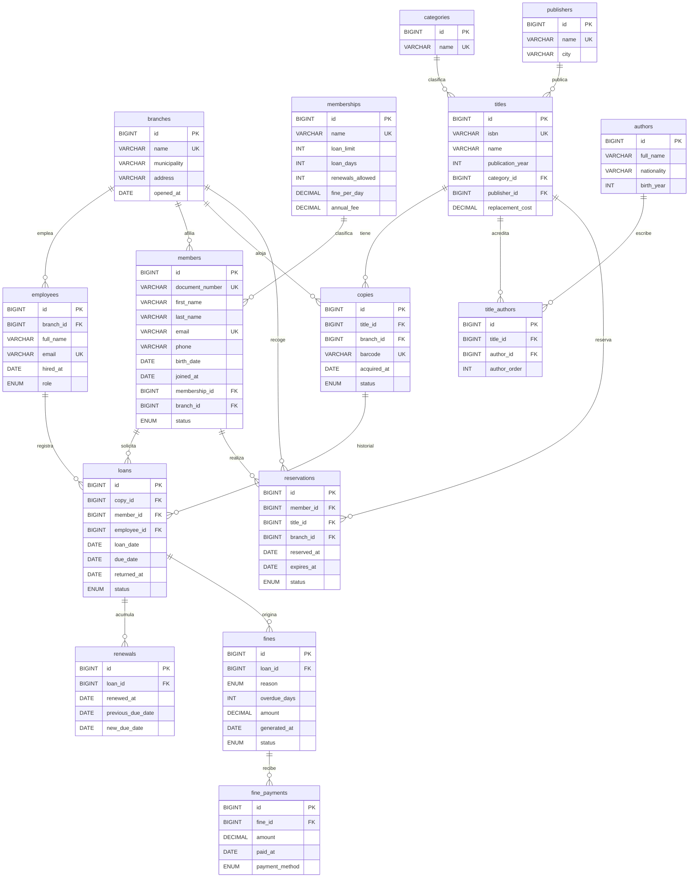

# Taller 1 – BiblioRed
**Estudiante:** Abdel Cristancho  
**Base de datos:** `bibliored`  
**Fecha de corte:** 2026-11-10

## Modelo entidad–relación

## Cardinalidades y participación
- Una sede emplea de cero a muchos empleados; cada empleado trabaja en exactamente una sede.
- Una sede afilia de cero a muchos socios; cada socio se afilia en exactamente una sede.
- Una sede aloja cero o muchos ejemplares; cada ejemplar está en exactamente una sede.
- Una membresía puede corresponder a muchos socios; cada socio tiene exactamente una membresía.
- Una categoría y una editorial pueden existir sin títulos; cada título pertenece a exactamente una categoría y una editorial.
- Un título tiene cero o muchos ejemplares; cada ejemplar corresponde a un título.
- Títulos y autores tienen relación N:M resuelta por `title_authors`; `author_order` es atributo de la relación. Se impide repetir autor en el mismo título y repetir posición.
- Un socio puede tener cero o muchos préstamos; cada préstamo corresponde a un socio, un ejemplar y un empleado.
- Un préstamo puede tener cero o muchas renovaciones y cero o muchas multas.
- Un socio puede crear cero o muchas reservas; cada reserva corresponde a un título y una sede de recogida.
- Una multa puede tener cero o muchos abonos.

## Normalización
- **1FN:** no guardar autores como texto separado por comas en `titles`; cada autoría ocupa una fila en `title_authors`.
- **2FN:** en la relación título–autor, el orden de autoría depende de la pareja título/autor y queda en la tabla puente; no se repite en `authors`.
- **3FN:** datos de membresía (topes y tarifas) se guardan una vez en `memberships`, no repetidos por socio. La editorial se separa de `titles`, evitando repetir ciudad editorial en cada título.
- **4FN:** no se detectan dos conjuntos multivaluados independientes en una misma tabla; autores y copias se modelan en relaciones separadas.

## Reglas que requieren procedimientos
Cálculo de vencimiento al prestar; elegibilidad del socio y del ejemplar; sincronía préstamo/ejemplar; renovación y bloqueo por reservas; cálculo de mora; vencimiento de reservas; límite de cuotas y cambio de estado de multa. La estructura por sí sola no puede validar agregados entre varias filas ni coordinar cambios en varias tablas.

## Respuestas a las preguntas guía
1. El título es la obra y el ejemplar es cada objeto físico; separar ambos evita repetir datos bibliográficos.
2. El orden pertenece a la relación título–autor.
3. La tarifa se cambia una vez en `memberships`.
4. El valor histórico queda congelado en `fines.amount`.
5. La multa llega al socio por `fines → loans → members`; duplicar `member_id` en multas permitiría inconsistencias.
6. Cada renovación se conserva en `renewals`.
7. El saldo se calcula como importe menos suma de abonos no anulados; no se almacena un saldo manual.
8. Se reserva un título, y la sede de recogida puede ser distinta de la sede de afiliación.
