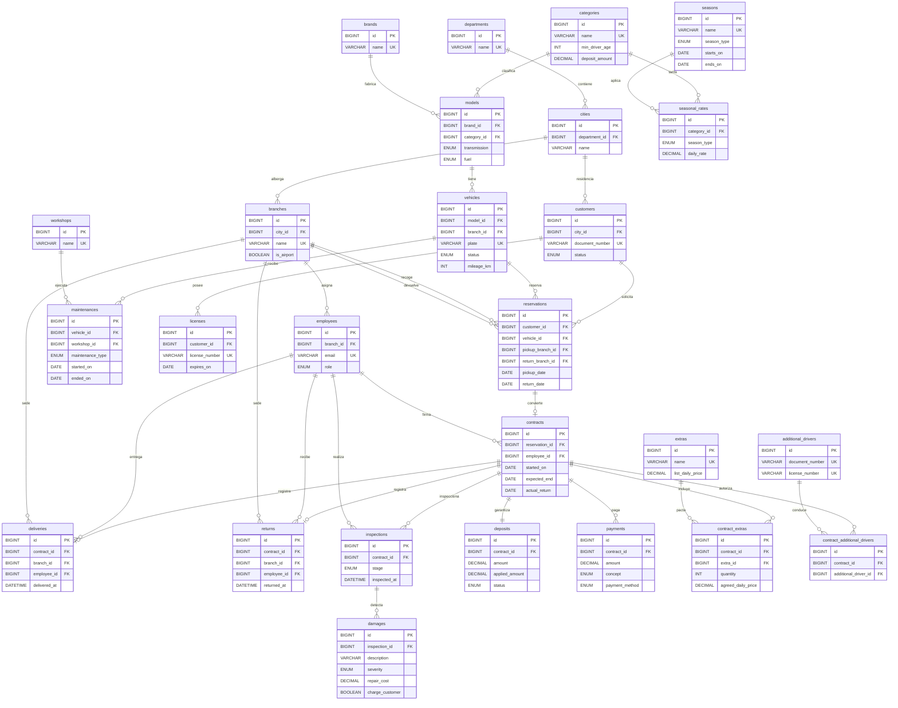

# Taller 2 – FlotaYa
**Estudiante:** Abdel Cristancho  
**Fecha de corte:** 2026-11-23

## Modelo ER (Mermaid)

## Cardinalidades y decisiones
- Departamento 0..N ciudades; ciudad 1..1 departamento y 0..N sedes; sede 1..1 ciudad.
- Las reservas tienen dos relaciones distintas con `branches`: sede de recogida y sede de devolución. Entrega y devolución también guardan su sede y empleado.
- Una reserva produce 0..1 contrato; cada contrato nace de exactamente una reserva. La FK única `contracts.reservation_id` impide dos contratos por reserva.
- Contrato–extra y contrato–conductor adicional son N:M y se resuelven con tablas puente. La cantidad y el precio diario pactado pertenecen a `contract_extras`.
- Cada contrato tiene como máximo una entrega y una devolución; una inspección por etapa, garantizada con UNIQUE(contract_id, stage).
- Los daños pertenecen a una inspección, no directamente al contrato. Un daño de entrega es previo y `charge_customer=FALSE`.
- Licencias se conservan como filas históricas; el adicional es entidad independiente y no necesita ser cliente.

## Normalización
**1FN:** sería defectuoso guardar `extras="GPS, silla, seguro"` en una sola columna. Se separa en `extras` y `contract_extras`, una fila por extra y contrato.

**2FN:** en una tabla puente con clave compuesta `(contract_id, extra_id)`, cantidad y precio pactado dependen de la pareja completa, no solo del contrato o del extra.

**3FN:** sería defectuoso repetir `category_name`, edad mínima y depósito en cada vehículo. Se guardan en `categories`, y `models` referencia la categoría. Las tarifas dependen de categoría + tipo de temporada, no de la temporada nominal.

**4FN:** no hace falta una descomposición adicional: licencias, extras, conductores y daños son hechos multivaluados independientes y ya están en relaciones separadas.

## Datos calculados vs almacenados
La edad se calcula con fecha de nacimiento y fecha de referencia. La cotización inicial se almacena como fotografía comercial; la función puede recalcularla. El alquiler final se recalcula al cierre con devolución real. El saldo se calcula como cargos menos pagos, no se almacena como valor editable.

## Preguntas guía
1. Reserva y contrato no son lo mismo: la reserva puede cancelarse; el contrato nace al convertirla. El cliente se obtiene desde la reserva y no se duplica.
2. El precio pactado se conserva en `contract_extras.agreed_daily_price`, aunque cambie el catálogo.
3. Son 6 × 3 = 18 tarifas. Dependen del tipo de temporada (BAJA/MEDIA/ALTA), no del nombre de cada temporada.
4. Edad mínima y depósito pertenecen a la categoría; ponerlos en vehículo o modelo duplica reglas y causa anomalías de actualización.
5. Se dibujan roles separados de FK hacia `branches` y `employees`, por ejemplo `pickup_branch_id` y `return_branch_id`.
6. El daño pertenece a `inspections`; la etapa identifica si fue previo (ENTREGA) o encontrado al devolver (DEVOLUCION).
7. Sí: cada renovación de licencia es una fila; el conductor adicional tiene tabla propia aunque no sea cliente.
8. Se almacenan hechos y precios pactados; edad, duración, noches, alquiler final y saldo se calculan desde fechas, tarifas y pagos.

## Reglas que no protege solo el DDL
| Regla | ¿DDL? | Motivo / solución |
|---|---|---|
| 6 continuidad de temporadas | Parcial | CHECK valida rango; huecos/cruces entre filas requieren procedimiento o validación |
| 8 cálculo por noche | No | Requiere recorrer días y unir temporadas/tarifas: función |
| 9 vehículo en mantenimiento | Parcial | Fechas con CHECK; coherencia del estado del vehículo requiere procedimiento |
| 14 cruce de reservas vivas | No | Requiere comparar otras filas: `sp_crear_reserva` |
| 15 cliente/edad/licencia/vehículo | No | Requiere varias tablas y fecha: `sp_crear_reserva` |
| 20 daño previo no cobrable | Parcial | FK a inspección; la etapa requiere lógica de negocio |
| 21 depósito aplicado no mayor al retenido | Sí | CHECK en la misma fila |
| 23 cierre todo-o-nada | No | Transacción y `sp_cerrar_contrato` |
